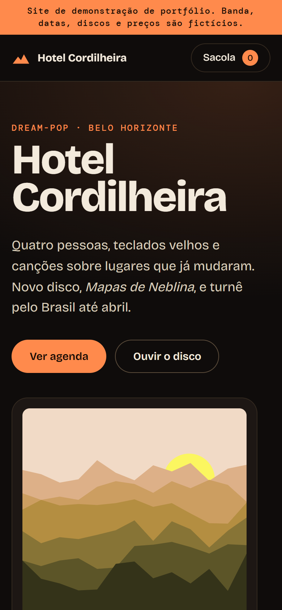
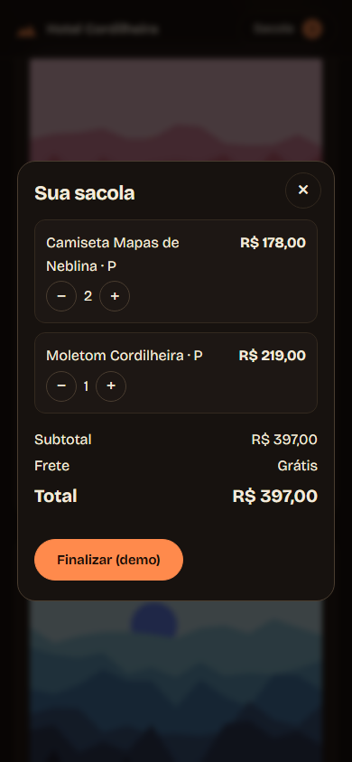

# Hotel Cordilheira

Website for a **fictional** indie dream-pop band: tour dates, discography with a simulated player, and a merch shop with a cart.
This is a portfolio demo. The band, dates, venues, releases and prices are all made up; no ticket, order or e-mail is ever sent or stored.

**Live:** https://alissonlittig.github.io/hotel-cordilheira/

| Desktop | Mobile | Cart (mobile) |
|---|---|---|
|  |  |  |

## Features
- Tour agenda with state/month filters, ticket reservation dialog with validation, and per-show `.ics` calendar download
- Discography: five releases with generated sleeve art, tracklists and a simulated player (no audio)
- Merch: size selection, cart persisted in `localStorage`, shipping rule (free above R$ 250), fake checkout
- Responsive down to 390px, no horizontal scroll, keyboard-friendly dialogs, reduced-motion support

## Stack
Eleventy 3 (static), vanilla ES modules, plain CSS, self-hosted Bricolage Grotesque and DM Mono. Sleeve art is generated at build time as seeded SVG, so there are no image files.

## Develop
```sh
npm ci
npm start      # dev server
npm test       # node:test unit tests for src/assets/logic.js
npm run build  # output in dist/
```

CI (`.github/workflows/pages.yml`) runs tests and build on every push, then deploys `dist/` to GitHub Pages from `main`.
